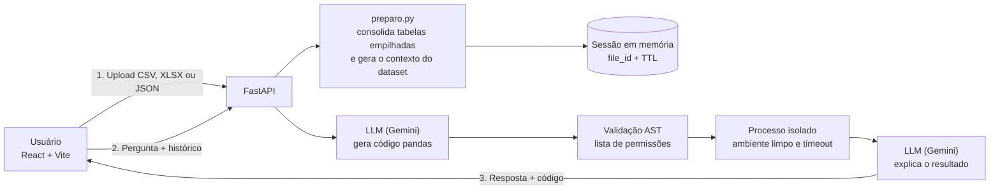

<p align="center">
  <picture>
    <source media="(prefers-color-scheme: dark)" srcset="frontend/public/TabulaRAG_Branco.png">
    
  </picture>
</p>

# 📊 TabulaRAG | Converse com Seus Dados Tabulares

Envie uma planilha (CSV, Excel ou JSON), faça perguntas em português e receba respostas **calculadas de verdade com pandas** — não estimadas pelo modelo — com o código gerado disponível na API para conferência. Sem cadastro e 100% gratuito.

<br>

Acesse o site em: [TabulaRAG](https://tabula-rag.vercel.app) (talvez seja necessário aguardar até 1 minuto para o Render acordar o servidor)

<br>

<p align="center">
  


<p align="center">


<p align="center">


<p align="center">


<br>
<br>


---

Diferente de um chatbot que "adivinha" números, o TabulaRAG usa o modelo de linguagem só para **escrever o código e explicar o resultado**. Quem calcula é o pandas, sobre o arquivo inteiro, e o código gerado passa por uma validação rigorosa antes de rodar em um processo isolado.


---

Com uma interface inspirada nos assistentes de IA modernos, tema escuro e layout responsivo, o painel lateral mostra o que foi carregado enquanto o chat acompanha o contexto da conversa.


<br>

# 🎯 Principais Funcionalidades

* **Upload de CSV, XLS, XLSX e JSON:** o arquivo é lido, resumido (linhas, colunas, tipos e prévia) e mantido apenas na memória do servidor durante a sessão.
* **Respostas Calculadas com Pandas:** o modelo recebe o esquema do dataset e a pergunta e devolve código pandas; o resultado real da execução é o que embasa a resposta final.
* **Consolidação Automática de Tabelas Empilhadas:** detecta arquivos em "formato longo", em que a mesma entidade aparece em várias linhas, cada uma com um bloco diferente de colunas preenchido, e consolida em uma linha por entidade para evitar contagens em dobro. No teste com `players_latest.csv`, 11.752 linhas viraram 1.468 (uma por jogador).
* **Contexto Automático do Dataset:** nomes e tipos de todas as colunas, amostra das primeiras linhas, valores das colunas categóricas e regras de resposta (português do Brasil, empates em rankings, tratamento de nulos).
* **Memória de Conversa:** as últimas mensagens acompanham cada pergunta, então follow-ups como "e o restante do top 10?" funcionam.
* **Autocorreção:** se o código gerado for recusado ou falhar, o erro volta ao modelo, que tenta de novo (até 3 tentativas).
* **Modelo Reserva (Fallback):** se o modelo principal estiver indisponível ou sobrecarregado, a chamada é refeita automaticamente com um segundo modelo.
* **Sessões com Prazo de Validade:** cada arquivo recebe um `file_id` aleatório, expira por inatividade e há limites de quantidade, tamanho e memória total.

<br>

# 🏗️ Arquitetura & Tecnologias

O projeto é um monorepo com backend e frontend desacoplados.



> **Por que "RAG"?** O nome faz referência à ideia de recuperação aumentada por geração: aqui, o "contexto recuperado" não são trechos de texto com embeddings, e sim o **resultado exato de um cálculo** feito sobre os dados. É uma abordagem de *text-to-code*, mais adequada a perguntas numéricas sobre planilhas do que a busca semântica.

### **Backend:**
* **Python 3.12 & FastAPI:** API REST com validação de entrada via Pydantic.
* **Pandas (+ openpyxl e xlrd):** leitura dos arquivos e execução dos cálculos.
* **Google Gemini (API compatível com OpenAI):** geração do código e explicação dos resultados, com modelos configuráveis por variável de ambiente e modelo reserva.
* **LangChain (`langchain-openai`):** cliente de chat usado nas chamadas ao modelo.
* **`subprocess` + AST:** validação e execução isolada do código gerado (detalhes na próxima seção).
* **Sessões em memória:** armazenamento próprio, seguro para threads, com expiração (TTL) e descarte dos menos usados.

### **Frontend:**
* **React 19 (com TypeScript):** interface reativa e tipada, com o contrato da API espelhado em `types.ts`.
* **Vite:** build tool e servidor de desenvolvimento.
* **Tailwind CSS v4:** estilização utilitária com tema escuro.
* **Lucide React:** ícones.

### **Estrutura do repositório:**

```
chatbot-rag/
├── backend/
│   ├── main.py             # rotas FastAPI (upload, chat, health)
│   ├── analise.py          # fluxo de 2 chamadas, validação AST e execução isolada
│   ├── runner_analise.py   # processo filho que executa o código já validado
│   ├── preparo.py          # consolidação de tabelas empilhadas e contexto do dataset
│   ├── sessoes.py          # armazenamento em memória com TTL e limites
│   ├── requirements.txt
│   └── .env.example
└── frontend/
    ├── src/                # components, config.ts, types.ts, App.tsx
    └── package.json
```

<br>

# 🔒 Execução Segura do Código Gerado

Executar código escrito por um modelo de linguagem é o maior risco deste tipo de aplicação, principalmente porque o **conteúdo das células do arquivo também pode tentar manipular o modelo** (*prompt injection*). A primeira versão usava o agente de pandas do LangChain com `allow_dangerous_code=True`; ela foi substituída por um fluxo fixo, com camadas de defesa:

1. **Geração restrita:** o modelo só pode responder com um bloco de código pandas que guarde o resultado em uma variável `resultado`.
2. **Validação por lista de permissões (AST):** o código é analisado antes de rodar. São recusados `import`, `def`, `class`, `while`, `try`, `with`, nomes como `eval`, `exec`, `open` e `getattr`, atributos iniciados por `_`, métodos de leitura e exportação (`read_*`, `to_csv`, `to_pickle`...), além de `query`, `eval` e `format`, entre outros.
3. **Processo separado:** o código válido roda em um `subprocess` Python isolado (`-I`), com ambiente limpo (sem chaves de API), diretório temporário vazio, *builtins* restritos e tempo limite configurável.
4. **Dados tratados como dados:** o conteúdo do arquivo é enviado ao modelo marcado como dado, nunca como instrução. Ele pode influenciar o texto da resposta, mas não executa código.
5. **Explicação sobre o resultado real:** a segunda chamada ao modelo recebe a saída verdadeira do pandas e é instruída a não inventar colunas, números ou valores.

<br>

# ☁️ Deploy e Infraestrutura (Produção)

O TabulaRAG está em produção, com backend e frontend hospedados separadamente:

* **Backend (Render):** a API em FastAPI roda como *Web Service* Python no [Render](https://render.com), com um único worker (os arquivos ficam na memória do processo) e endpoint `/health` para verificação de saúde.
* **Frontend (Vercel):** a interface em React/Vite é publicada no [Vercel](https://vercel.com), com a URL da API injetada em tempo de build pela variável `VITE_API_URL`.
* **CORS Controlado:** os domínios autorizados são liberados explicitamente pela variável `ALLOWED_ORIGINS` no backend, sem wildcard aberto.
* **Continuous Deployment (CI/CD):** backend e frontend estão conectados ao repositório no GitHub, e cada `git push` na branch `main` dispara um novo deploy em cada plataforma.
* **Segurança Cloud-Native:** chaves e configurações não são versionadas; toda a configuração é injetada pelas *Environment Variables* de cada plataforma.

<br>

# 🚧 Limitações Conhecidas e Próximas Funcionalidades

### **Limitações atuais**

* **Hospedagem gratuita:** o Render desliga o serviço após cerca de 15 minutos sem acesso, e a primeira requisição depois disso pode levar aproximadamente 1 minuto. Como os arquivos ficam em memória, **a sessão se perde** quando o servidor dorme ou reinicia, e o usuário precisa reenviar o arquivo.
* **Sem persistência:** nada é gravado em disco ou banco de dados. Há limites configuráveis de tamanho de arquivo, número de sessões e memória total.
* **Privacidade:** o arquivo vai para o servidor, e trechos dos dados (colunas, amostra das primeiras linhas e resultados dos cálculos) são enviados ao provedor do modelo (Google Gemini). Consulte os termos do plano gratuito do provedor e **não envie dados sensíveis**.
* **Precisão:** o código é gerado por um modelo de linguagem e pode interpretar mal colunas ambíguas (por exemplo, o que um valor vazio significa). Verifique os dados críticos antes de decidir com base nas respostas.
* **Isolamento:** a validação por lista de permissões somada ao processo separado reduz muito o risco, mas **não equivale a uma sandbox completa**: não há limite de memória ou CPU por execução além do tempo limite. Em ambientes mais críticos, o ideal é somar isolamento em nível de contêiner.
* **API pública:** não há autenticação nem limite de requisições por IP, e a cota do modelo gratuito é compartilhada por todos os visitantes.
* **Escopo dos dados:** um arquivo por sessão; em arquivos Excel, apenas a primeira planilha é lida; ainda não há geração de gráficos.
* **Latência:** cada pergunta envolve ao menos duas chamadas ao modelo e a abertura de um processo, e a velocidade dos modelos gratuitos varia.

### **Em desenvolvimento / planejado**

- [ ] **Escolha entre modelos:** seletor na interface, com lista definida pelo servidor e apenas modelos gratuitos ou de cota generosa.
- [ ] **Adicionar contexto:** campo de texto livre para explicar os dados ao modelo (por exemplo, "valores vazios em gols significam zero").
- [ ] **Exportar a conversa:** download em Markdown com perguntas, respostas e código usado, e resumo gerado pelo modelo.
- [ ] **Múltiplos arquivos:** vários DataFrames na mesma sessão, com perguntas que cruzam tabelas.
- [ ] **Limite de requisições por IP** e outras proteções para a API pública.
- [ ] **Testes automatizados** (validação do código, execução isolada, sessões e rotas) com integração contínua.
- [ ] **Gráficos** gerados a partir das respostas.

<br>

# ⚙️ Como Executar o Projeto Localmente

### **Pré-requisitos**
* Python 3.12+ e Node.js (versão compatível com o Vite 8)
* Uma chave gratuita da API do Gemini, criada no [Google AI Studio](https://aistudio.google.com/apikey)

### **Backend**

```bash
git clone https://github.com/AlysonMLL/chatbot-rag.git
cd chatbot-rag/backend

python -m venv venv
# Windows (PowerShell): .\venv\Scripts\Activate.ps1
# Linux/macOS:          source venv/bin/activate

pip install -r requirements.txt
cp .env.example .env    # edite o .env e preencha LLM_API_KEY

uvicorn main:app --reload
```

Acesse **http://localhost:8000/docs** para a documentação interativa da API.

> Com `--reload`, qualquer alteração em um arquivo `.py` reinicia o servidor e **apaga as sessões em memória**: depois de editar o código, envie o arquivo novamente.

### **Frontend**

```bash
cd chatbot-rag/frontend
npm install
npm run dev
```

Acesse **http://localhost:5173** para visualizar a interface.

> Por padrão o frontend usa `http://localhost:8000` como URL da API. Para apontar para outro endereço, defina `VITE_API_URL` no arquivo `.env` do frontend.

### **Variáveis de Ambiente (backend)**

| Variável | Descrição | Padrão |
|---|---|---|
| `LLM_API_KEY` | Chave da API do provedor do modelo | — |
| `LLM_BASE_URL` | Endereço da API compatível com OpenAI | endpoint do Gemini |
| `LLM_MODEL` | Modelo principal | — |
| `LLM_MODEL_FALLBACK` | Modelo reserva, usado se o principal falhar | — |
| `ALLOWED_ORIGINS` | Origens liberadas no CORS, separadas por vírgula | `http://localhost:5173` |
| `MAX_UPLOAD_MB` | Tamanho máximo do arquivo enviado | `10` |
| `SESSAO_TTL_MIN` | Minutos de inatividade até a sessão expirar | `30` |
| `MAX_SESSOES` | Máximo de sessões simultâneas | `20` |
| `MAX_MEMORIA_MB` | Memória total máxima dos arquivos em sessão | `300` |
| `TIMEOUT_EXECUCAO` | Tempo limite, em segundos, para executar o código gerado | `20` |

> Os nomes de modelo mudam com frequência. Se um deles deixar de estar disponível, consulte a lista de modelos da sua chave no Google AI Studio e atualize `LLM_MODEL` e `LLM_MODEL_FALLBACK`.

### **Endpoints da API**

| Método | Rota | Descrição |
|---|---|---|
| `POST` | `/api/upload` | Envia o arquivo e devolve `file_id`, resumo, colunas, prévia e eventual nota de consolidação |
| `POST` | `/api/chat` | Responde a uma pergunta sobre o arquivo da sessão |
| `DELETE` | `/api/files/{file_id}` | Libera da memória o arquivo da sessão |
| `GET` | `/health` | Verificação de saúde do serviço |

Exemplo de requisição ao `/api/chat`:

```json
{
  "file_id": "3f2a9c1e5b7d4e6f8a0b1c2d3e4f5a6b",
  "question": "E o restante do top 10?",
  "history": [
    { "role": "user", "content": "Quais os 5 jogadores com mais gols?" },
    { "role": "assistant", "content": "Os 5 jogadores com mais gols são: ..." }
  ]
}
```

Resposta:

```json
{
  "answer": "Do 6º ao 10º lugar, ...",
  "code": "resultado = df.nlargest(10, 'goals')[['player_name', 'goals']].iloc[5:]"
}
```

Erros tratados: `400` (formato não suportado), `404` (sessão expirada), `413` (arquivo grande demais), `422` (arquivo ilegível ou pergunta sem resposta segura) e `503` (serviço de IA indisponível).

<br>

---

<br>

<p align="center">
  
  
  
  
  
  
  
  
  
  
  
  
  
  
  
</p>
